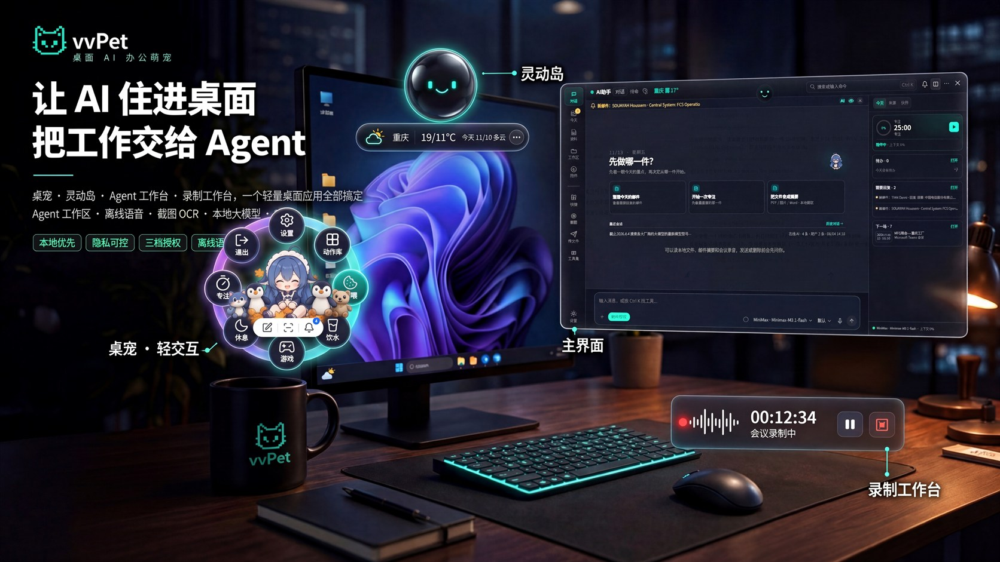

<div align="center">

<p>
  <a href="README.md">中文</a> · <b>English</b>
</p>

<p>
  <a href="https://github.com/cqzmc/vvpet-release/releases"></a>
  <a href="https://github.com/cqzmc/vvpet-release/stargazers"></a>
  <a href="https://github.com/cqzmc/vvpet-release/releases"></a>
  
  
  
  
</p>

<h3>Bring AI to your desktop without breaking focus: chat, reminders, translation, screenshots, meetings, and local search in one lightweight companion.</h3>

<p>
  <b>🐳 Whale girl pet · 🤖 Agent workbench · 🎙️ Offline ASR · 🗣️ Online/offline TTS · 🍅 Pomodoro · 📝 Recording workbench · 🔤 Selection translation · 📄 Document OCR · 🧠 Local LLM · 📧 Mail digest · 🏝️ Dynamic island · 📸 Screenshot toolkit · 🌍 Multilingual</b>
</p>

<p>
  <a href="https://github.com/cqzmc/vvpet-release/releases"></a>
  <a href="#quick-start"></a>
</p>

</div>



## Why vvPet

vvPet is a Windows desktop AI office pet. It combines a **resident pet, Agent workbench, dynamic island, screenshots, translation, recording and meeting notes, Pomodoro, and local model management** in one lightweight desktop app. It uses local capabilities by default and calls remote services only when you explicitly ask for them.

vvPet combines a quiet desktop companion with an executable Agent workbench: use quick chat and reminders by the pet, or open a trusted workspace and actually finish the documents and code.

## Recent Highlights · v0.1.39

- **Office navigation cleanup**: Quick Tools is gone and its slot is now Recording; the Pomodoro timer moved into Today and Mail Summary moved into the Mail Summary tab, leaving one entry for recording, focus and summaries.
- **Tighter Today page**: focus and to-dos share an equal-width two-column layout; the focus duration is adjusted by hovering the ring and clicking ±1 minute, with the slider removed.
- **Models and safety**: saved API keys are never shown again and are only replaced by entering a new key; Kimi/GLM/MiMo/OpenAI presets are removed, the local model sits after the enterprise gateway, and the trusted-directory bar is pinned above the composer for quick switching.
- **Workspace records**: Skills opens by default; execution records and file changes are merged into Records with history deletion and attention badges; the duplicate Skills page under Engine is removed and its presets/advanced arguments moved into the workspace.
- **Companion and UI**: the action library joins the companion toolbar and expands upward into seven groups plus All; the same mail appears only once in chat; Settings, Recording and the island no longer show a close X, and Engine tabs use the solid cyan selected style.

### v0.1.37

- **Real streaming output**: the chat page used to wait for the whole answer before showing anything. It now consumes the real SSE stream and renders text as it arrives; thinking is shown separately, and stopping keeps what already arrived while ignoring late events.
- **Per-model brief budget**: MiniMax M3.1 Flash now gets a 131072 total output budget and `low` reasoning effort, fixing briefs that came back empty because the model ran out of budget while thinking. An explicit output cap you set is respected; other models keep their existing strategy.
- **Companion web lookup**: the companion page can look up real information on demand (Bing search RSS, Baidu trending, Seniverse weather) with "Automatic / Every message / Off". Only the query text or city is sent, and sources are saved with the reply for hover inspection.
- **Island entries and fuller presets**: the island carousel gains always-discoverable "Start focus" and "Screenshot" cards; the three personality presets now fill personality, speaking style, interests and example dialogue, and enable character feelings.
- **Capture sounds**: screenshot capture and "Save as" use a project-generated 0.22 s shutter and 0.30 s confirmation tone, embedded in the binary with no online request.

### v0.1.36

- **Character settings**: the companion chat header now edits the character name, how it addresses you, personality, speaking style, interests and example dialogue; three personality presets apply in one click while keeping existing interests and examples, with a separate reset action.
- **Reply language and conversation style**: replies can follow the interface, stay Chinese, stay English, or come back as a Chinese + English pair; conversation style offers natural, thoughtful or creative, all persisted on their own.
- **Companion voice playback**: read replies in Chinese or English, read the latest reply, preview a fixed sample, or enable automatic reading. Automatic reading is off by default and only covers newly generated replies in this page, never history or character feelings.
- **Native Edge synthesis fixes**: the missing WebSocket handshake headers are added and the current v2 challenge protocol is supported, fixing the 403 that broke playback. Chinese is pinned to Xiaoyi and English to Ana, without touching the main chat voice settings.

### v0.1.35

- **Domestic mail accounts**: QQ and 163 connect over read-only IMAP with TLS, and the authorization code is stored in the Windows Credential Manager. A dedicated Mail page in the left rail configures accounts, tests the connection, syncs and opens the original message; enabled accounts sync incrementally every two minutes.
- **Daily brief cleanup**: “Add selected”, “Open to-dos” and “Update brief” share one action bar; suggested actions come from real mail evidence and join the same to-do list without duplicates.
- **163 cursor compatibility**: when the server omits UIDNEXT, the client now reads the real UID of the last message instead of trusting a count, so account setup no longer stops at “mailbox did not provide a valid sync cursor”.
- **Companion page, phase one**: an independent AI conversation, memories you can review and edit, real to-do context and opt-in proactive care; replies also appear in the pet bubble and never carry office history or tool permissions.

### v0.1.33

- **Agent workbench**: Ask, Smart and Always approval levels with independent trusted-directory checks; agent settings now live under Engine.
- **Expanded workspace**: trusted local folders, file browsing and editing, change/artifact history, backups, restore and task records.
- **Code and document execution**: exact text patches, verified writes, bounded Python/Node/npm/Cargo/Git execution, real exit results and Windows process cancellation.
- **Recording workbench**: start recording or screen capture directly, with a shared timer and level bar; audio lands on disk, gets transcribed offline and turned into minutes, while the editor handles MP4 conversion, subtitles and resumable transfers.
- **Lightweight pet controls**: a white dock follows the visible pet artwork, with compose, screenshot and notification controls; the light single-line input collapses on blur and preserves drafts, with useful reminders and replies in its inbox.
- **Capture and island**: window/native-control snapping, annotation tools above and actions below; PNG captures save to the system Downloads folder by default, with separate Save as and Attach to chat actions. Weather symbols follow conditions; the island has rounded loading and retry states.
- **Model connections**: saved provider connections, endpoint-specific credentials, model discovery and direct model/context/reasoning selection in the composer.
- **Compact conversations**: content-sized bubbles, hover actions, copy feedback, edit/resend, context estimates and compaction commands.
- **Office-friendly behavior**: distinct Office, Hybrid and Companion behavior; scrolling island notices and consistent full-width office pages.
- **File transfer and details**: embedded WeChat file transfer, action-library cards and a separately scrolling engine list; existing voice, capture, meeting and local-model features remain.

See [release notes](CHANGELOG.md).

- **Daily brief**: when enabled, opening the main window shows today’s saved brief or generates one with the selected model. Suggestions can be added to to-dos. Remote models receive the office data needed for the brief (mail, calendar, chat and tasks); disable daily briefs in System settings or select a local model if needed.
- **Engines and daily planning**: extensions, runtimes (including OCR), skills and agent tools share four sections. Pinned resources download up to three files at once and reuse verified payloads. Today restores saved daily briefs and links suggested actions to the same to-do list without duplicates.
- **Offline engine repairs**: pinned, multi-source verified Python/OCR/Kokoro installs with real invocation probes; fixed interactive local Qwen calls and truncated embedding models. Mail assessment uses the currently configured language model on request, with human review.
- **Pre-release fixes**: stale connection/key results, disappearing long-running task notices, and shared transcript protection after partial recording deletion failures.

## Highlights

| Capability | What it does |
| --- | --- |
| 🐳 Resident pet | Whale girl by default, Pixel Cat compatible; right-click menu, expressions, floating notices, and companion-stage interactions |
| 💞 Companion assistant | Editable character settings (name, personality, speaking style, interests and example dialogue), three personality presets, reply language and conversation style, manageable memories and voice playback, on-demand web lookup with sources |
| 🤖 Agent assistant | Three approval levels, model connections, enterprise gateway, bounded tools, step budget, task history and explicit resume |
| 📂 Workspace | Browse, create, rename, delete, preview, and edit text inside authorized folders; hand work to the Agent |
| 🧑‍💻 Code and document execution | Exact text patches, verified writes, bounded Python/Node/npm/Cargo/Git runs, real exit codes |
| 🎙️ Recording workbench | Audio and screen recording, shared timer and level bar, offline transcription, generated minutes, MP4 conversion and subtitles |
| 🧠 Local LLM | Local GGUF / llama.cpp runtime and model management for offline and privacy-first workflows |
| 🎙️ Offline ASR | Whisper / SenseVoice offline recognition with runtime and model management |
| 🗣️ Text-to-speech | Edge TTS online first (Xiaoxiao / Aria in the main chat, Xiaoyi / Ana on the companion page); offline Piper fallback; optional Kokoro ONNX bilingual; Windows system voice as the final fallback |
| 🍅 Pomodoro | Focus timer, todos, priority, event size, postpone / complete / delete, and pet-state sync |
| 📝 Meeting notes | Meeting recording, local saving, offline transcription, generated minutes, and attachment handoff |
| 🔤 Selection translation | Translate, summarize, add to todo, copy, or continue in chat from a lightweight popup |
| 📸 Screenshot toolkit | Region capture, window snapping, annotation, mosaic, text, shapes, local OCR, copy, and chat attachments; project-generated shutter and confirmation tones |
| 📄 Document OCR | PDF text extraction, image OCR, local preview, and context injection; PPTX is read-only |
| 📧 Mail digest | Local Outlook COM and read-only QQ/163 IMAP for reminders, briefs and mail actions |
| 📋 Daily brief | Today's brief opens with the main window; suggestions trace back to real mail sentences and can become to-dos; the output budget is chosen per model |
| 🏝️ Dynamic island | Compact status island for screenshots, reminders, search, Pomodoro, recording, editing and downloads |
| 📨 File transfer | WeChat file transfer assistant embedded directly in the main window |
| 🌍 Multilingual UI | Chinese, English, and French across chat, settings, island, pet menu, and translation windows |

## Three approval levels

Every edit, program run and web request is decided by the approval level on the left of the composer:

| Level | Behavior |
| --- | --- |
| Ask first | Ask before edits, programs or web access |
| Smart approval | Create and patch automatically; overwrites and executions still need approval |
| Always | Run automatically inside the trusted scope; irreversible operations are approved separately |

The scope is “App and trusted directories”, checked independently from directory trust.

## Voice and Models

### Speech chain

```text
Edge TTS online (Xiaoxiao / Aria)
      ↓ unavailable
Online backup voice
      ↓ unavailable
Piper offline (en_US-lessac-medium / zh_CN-huayan-medium)
      ↓ unavailable
Windows system voice
```

When Kokoro is selected:

```text
Kokoro ONNX (v1.1-zh int8, Chinese + English)
      ↓ unavailable
Piper offline
      ↓ unavailable
Windows system voice
```

> Kokoro requires a one-time Python dependency install (`kokoro-onnx`, etc.) and a roughly 168 MB model download. After that it works offline. CPU synthesis takes a few seconds.

### Companion page speech

The companion page uses its own Edge synthesis entry with Chinese pinned to `zh-CN-XiaoyiNeural` and English pinned to `en-US-AnaNeural`, independent of the main chat voice settings:

```text
Edge TTS online (companion: Xiaoyi / Ana)
      ↓ unavailable
Playback error (no other voice is substituted)
```

The companion page and the main chat share playback ownership: stopping cancels the native synthesis and discards late results.

### Models and runtimes

| Model / runtime | Purpose | Source and fallback |
| --- | --- | --- |
| Whisper / SenseVoice | Offline ASR | HuggingFace ↔ hf-mirror |
| Kokoro v1.1-zh int8 | Bilingual offline TTS | GitHub Release ↔ ghfast / gh-proxy |
| Piper lessac / huayan | Offline TTS fallback | HuggingFace ↔ hf-mirror |
| bge-small-zh-v1.5 | Local vector retrieval | HuggingFace ↔ hf-mirror |
| Qwen2.5 0.5B GGUF | Local chat | HuggingFace ↔ hf-mirror |
| llama.cpp / sherpa-onnx | Local runtimes | GitHub ↔ ghfast / gh-proxy |
| RapidOCR | Local OCR | HuggingFace ↔ hf-mirror |
| Python 3.12 | Documents / OCR / skills / Kokoro | Tsinghua ↔ python.org |

## Workflows

- **Ask quickly**: open chat from the pet menu or a shortcut and ask directly.
- **Hand over the work**: let the Agent edit documents and run scripts inside a trusted directory, verify the write afterwards, and restore a backup if something goes wrong.
- **Summarize meetings**: record locally, transcribe offline, then generate minutes.
- **Read documents without leaving the desktop**: upload PDFs, images, or documents, extract text locally, then summarize or translate.
- **Capture and process screenshots**: capture, annotate, OCR, translate, copy, or send to the AI.
- **Stay focused**: run Pomodoro sessions while important mail and reminders appear through the pet or island.
- **Speak offline**: install Piper or Kokoro and read messages even without a network.

## Windows and Architecture

vvPet is composed of several Tauri windows that cooperate:

| Window | Purpose |
| --- | --- |
| `chat` | Main chat, tools, settings, workspace, library, mail, companion, and history |
| `pet` | Transparent always-on-top desktop pet and quick menu |
| `pet-quick` | Lightweight pet dock for quick chat, capture, and recent notices |
| `island` | Compact status island and quick actions |
| `rec-bar` | Recording bar with shared timer, level meter, and pause/stop |
| `rec-editor` | Editing workbench for conversion, subtitles, and export |
| `capture` | Screenshot capture and annotation |
| `selection-translate` | Selection translation popup |

## Tech Stack

| Layer | Technologies |
| --- | --- |
| Desktop | Tauri 2, Rust, NSIS |
| Frontend | Vue 3, TypeScript, Vite, vue-i18n |
| Local capability | SQLite FTS5, Windows Credential Manager, Windows COM, WebView2 |
| AI / Voice | OpenAI-compatible APIs, enterprise gateway, llama.cpp / GGUF, Whisper, SenseVoice, Edge TTS, Piper, Kokoro ONNX |

## Quick Start

### Install

Download the Windows installer from [GitHub Releases](https://github.com/cqzmc/vvpet-release/releases).

Release builds are generated at:

```text
vv/src-tauri/target/release/bundle/nsis/vvPet_<version>_x64-setup.exe
```

### Develop Locally

Requirements:

- Windows 10 / 11
- Node.js 18+
- Rust stable
- Visual Studio C++ Build Tools
- Microsoft Edge WebView2

```bash
cd vv
npm install
npm run dev
```

Common commands:

```bash
npm run check            # Vue / TypeScript type check
npm run build:frontend   # Build frontend assets
npm run build:app        # Build frontend + Tauri / NSIS installer
npm run test:rust        # Rust tests
```

Frontend contract tests:

```bash
node --experimental-strip-types --test src/*.test.mjs tests/*.test.ts
```

## Model Downloads and Network

vvPet prefers official sources and provides reachable mirrors:

- HuggingFace ↔ `hf-mirror.com`
- GitHub Release ↔ `ghfast.top` / `gh-proxy.com`
- Python ↔ Tsinghua mirror / `python.org`
- FFmpeg ↔ npmmirror / gyan.dev / GitHub

Models, runtimes, and Python packages live in the local application data directory and survive app upgrades.

## Privacy and Local-First Design

| Data | Handling |
| --- | --- |
| API keys / tokens | Stored in Windows Credential Manager, not plaintext config files |
| Local search | Indexes only directories explicitly authorized by the user |
| Documents and screenshots | Parsed locally by default; model context is triggered by user action |
| Meeting audio | Saved locally, with offline transcription preferred |
| Outlook mail | Read through local COM integration, without a relay service |
| QQ/163 mail | Direct encrypted IMAP; authorization codes stay in Windows Credential Manager. The Mail page provides account setup, official guides and recent messages; initial support polls every two minutes |
| Companion web lookup | When enabled, only the current query text or weather city is sent to public search / trending / weather services. **No** memories, office chats or character settings are sent; results are treated as untrusted input and shown with sources |
| Offline voice models | Stored under local application data |
| Online TTS / translation | Text is sent only when you trigger speech or translation; Piper / Kokoro can be used offline |
| Program execution | Runs with the current Windows account rights; a fixed working directory is not an OS sandbox |

## Repository Layout

```text
vvpet/
├─ docs/                 Product docs, proposals, and validation records
├─ vv/                   Main application
│  ├─ src/               Vue frontend source
│  ├─ src/i18n/          Locale resources
│  ├─ src-tauri/         Rust / Tauri backend
│  ├─ public/            Pets and static assets
│  └─ scripts/           Build and release scripts
├─ showcase/             Showcase site source
├─ images/               README and documentation artwork
├─ AGENTS.md             Repository collaboration instructions
├─ CHANGELOG.md          Release notes
├─ README.md             Chinese README
└─ README.en.md          English README
```

## Languages

Built in:

- Chinese
- English
- French

---

<div align="center">

If vvPet helps you, consider starring the release repository.

</div>

## Project Stats

<div align="center">

<a href="https://star-history.com/#cqzmc/vvpet-release&Date">
  
</a>

<br>

<a href="https://github.com/cqzmc/vvpet-release/stargazers">
  
</a>
<a href="https://github.com/cqzmc/vvpet-release/releases">
  
</a>
<a href="https://github.com/cqzmc/vvpet-release/releases/latest">
  
</a>

</div>

## License

MIT
