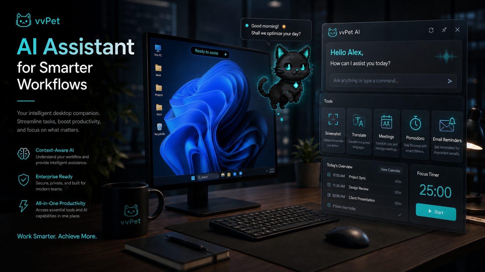
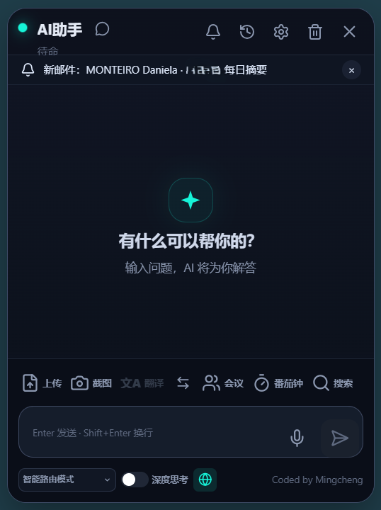
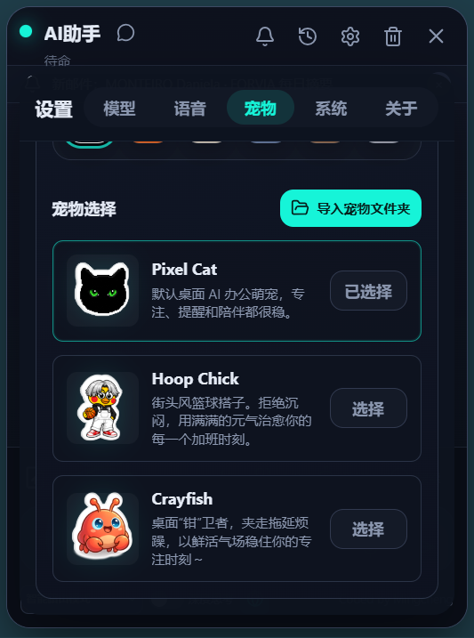
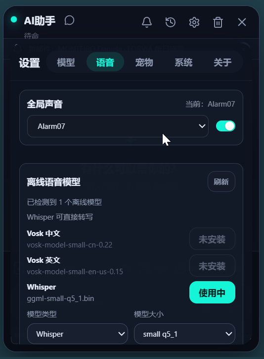

<div align="center">

<p>
  <a href="README.md">中文</a> · <b>English</b>
</p>

<p>
  <a href="https://github.com/cqzmc/vvpet-release/releases"></a>
  <a href="https://github.com/cqzmc/vvpet-release/stargazers"></a>
  <a href="https://github.com/cqzmc/vvpet-release/releases"></a>
  
  
  
  
</p>

<h3>Bring AI to your desktop without breaking focus: chat, reminders, translation, screenshots, meetings, and local search in one lightweight companion.</h3>

<p>
  <b>🐳 Whale girl pet · 🤖 Agent assistant · 🎙️ Offline ASR · 🗣️ Online/offline TTS · 🍅 Pomodoro · 📝 Meeting notes · 🔤 Selection translation · 📄 Document OCR · 🧠 Local LLM · 📧 Mail digest · 🏝️ Dynamic island · 📸 Screenshot toolkit · 🌍 Multilingual</b>
</p>

<p>
  <a href="https://github.com/cqzmc/vvpet-release/releases"></a>
  <a href="#quick-start"></a>
</p>

</div>

<br>



<br>

## Why vvPet

vvPet is a Windows desktop AI office pet. It combines a **resident pet, Agent assistant, dynamic island, screenshots, translation, meeting notes, Pomodoro, and local model management** in one lightweight desktop app. It uses local capabilities by default and calls remote services only when you explicitly ask for them.

It is not a huge all-in-one workspace. It is a low-interruption desktop companion: it stays in a corner or in the dynamic island, and expands into a focused chat surface when needed.

## Recent Highlights

- **Whale girl is now the default pet.** Fresh installs and the old Pixel Cat default are migrated to Whale girl; Pixel Cat remains selectable in settings.
- **Kokoro ONNX bilingual offline speech.** `kokoro-onnx` with `zf_001` for Chinese and `af_maple` for English; the runtime and model are installed on demand.
- **Multi-level TTS fallback.** Edge TTS online first (Xiaoxiao / Aria), then an online backup, then offline Piper, then the Windows system voice.
- **Agent is the default mode.** Switch back to Chat at any time. The first visit to the Agent settings no longer runs a blocking network capability probe.
- **Companion restored.** The left rail, `Ctrl+4`, and `Ctrl+Shift+M` open the companion stage; the old left pet avatar flyout remains removed.
- **Translation flow rebuilt.** A Translate button sits next to Send and sends immediately; the result card is a fixed floating panel, fixing the old vertical/clipped layout.
- **Light theme fixes.** Quick Tools, Pomodoro, About, Quick Studio, system settings, and other surfaces no longer keep dark slabs.
- **Screenshot improvements.** Horizontally scrollable toolbar on narrow screens, compact color swatch, `Ctrl+C` copy, and `Ctrl+S` save.
- **Model source fallbacks.** HuggingFace ↔ hf-mirror, GitHub ↔ ghfast / gh-proxy, Python ↔ Tsinghua / python.org.

## Highlights

| Capability | What it does |
| --- | --- |
| 🐳 Resident pet | Whale girl by default, Pixel Cat compatible; right-click menu, expressions, floating notices, and companion-stage interactions |
| 🤖 Agent assistant | Agent by default; multi-model setup, enterprise gateway, OpenAI-compatible APIs, deep thinking, web search, and chat history |
| 🧠 Local LLM | Local GGUF / llama.cpp runtime and model management for offline and privacy-first workflows |
| 🎙️ Offline ASR | Whisper / SenseVoice offline recognition with runtime and model management |
| 🗣️ Text-to-speech | Edge TTS online first; offline Piper fallback; optional Kokoro ONNX bilingual; Windows system voice as the final fallback |
| 🍅 Pomodoro | Focus timer, todos, priority, event size, postpone / complete / delete, and pet-state sync |
| 📝 Meeting notes | Meeting recording, local saving, offline transcription, generated minutes, and attachment handoff |
| 🔤 Selection translation | Translate, summarize, add to todo, copy, or continue in chat from a lightweight popup |
| 📸 Screenshot toolkit | Region capture, annotation, mosaic, text, shapes, local OCR, copy, and chat attachments |
| 📄 Document OCR | PDF text extraction, image OCR, local preview, and context injection; PPTX is read-only |
| 📧 Mail digest | Outlook unread-mail reminders through local COM integration |
| 🏝️ Dynamic island | Compact status island for screenshots, reminders, search, Pomodoro, todos, and downloads |
| 📂 Workspace | Browse, create, rename, delete, preview, and edit text inside authorized folders; hand work to the Agent |
| 🌍 Multilingual UI | Chinese, English, and French across chat, settings, island, pet menu, and translation windows |

## Voice and Models

### Speech chain

```text
Edge TTS online (Xiaoxiao / Aria)
      ↓ unavailable
Online backup voice
      ↓ unavailable
Piper offline (en_US-lessac-medium / zh_CN-huayan-medium)
      ↓ unavailable
Windows system voice
```

When Kokoro is selected:

```text
Kokoro ONNX (v1.1-zh int8, Chinese + English)
      ↓ unavailable
Piper offline
      ↓ unavailable
Windows system voice
```

> Kokoro requires a one-time Python dependency install (`kokoro-onnx`, etc.) and a roughly 168 MB model download. After that it works offline. CPU synthesis takes a few seconds.

### Models and runtimes

| Model / runtime | Purpose | Source and fallback |
| --- | --- | --- |
| Whisper / SenseVoice | Offline ASR | HuggingFace ↔ hf-mirror |
| Kokoro v1.1-zh int8 | Bilingual offline TTS | GitHub Release ↔ ghfast / gh-proxy |
| Piper lessac / huayan | Offline TTS fallback | HuggingFace ↔ hf-mirror |
| bge-small-zh-v1.5 | Local vector retrieval | HuggingFace ↔ hf-mirror |
| Qwen2.5 0.5B GGUF | Local chat | HuggingFace ↔ hf-mirror |
| llama.cpp / sherpa-onnx | Local runtimes | GitHub ↔ ghfast / gh-proxy |
| RapidOCR | Local OCR | HuggingFace ↔ hf-mirror |
| Python 3.12 | Documents / OCR / skills / Kokoro | Tsinghua ↔ python.org |

## Interface

| Main window | Pet selection |
| --- | --- |
|  |  |

| Voice models | Dynamic island |
| --- | --- |
|  |  |

## Workflows

- **Ask quickly**: open chat from the pet menu or a shortcut and ask directly.
- **Summarize meetings**: record locally, transcribe offline, then generate minutes.
- **Read documents without leaving the desktop**: upload PDFs, images, or documents, extract text locally, then summarize or translate.
- **Capture and process screenshots**: capture, annotate, OCR, translate, copy, or send to the AI.
- **Stay focused**: run Pomodoro sessions while important mail and reminders appear through the pet or island.
- **Speak offline**: install Piper or Kokoro and read messages even without a network.

## Windows and Architecture

vvPet is composed of several Tauri windows that cooperate:

| Window | Purpose |
| --- | --- |
| `chat` | Main chat, tools, settings, workspace, library, and history |
| `pet` | Transparent always-on-top desktop pet and quick menu |
| `island` | Compact status island and quick actions |
| `capture` | Screenshot capture and annotation |
| `selection-translate` | Selection translation popup |

## Tech Stack

| Layer | Technologies |
| --- | --- |
| Desktop | Tauri 2, Rust, NSIS |
| Frontend | Vue 3, TypeScript, Vite, vue-i18n |
| Local capability | SQLite FTS5, Windows Credential Manager, Windows COM, WebView2 |
| AI / Voice | OpenAI-compatible APIs, enterprise gateway, llama.cpp / GGUF, Whisper, SenseVoice, Edge TTS, Piper, Kokoro ONNX |

## Quick Start

### Install

Download the Windows installer from [GitHub Releases](https://github.com/cqzmc/vvpet-release/releases).

Release builds are generated at:

```text
vv/src-tauri/target/release/bundle/nsis/vvPet_<version>_x64-setup.exe
```

### Develop Locally

Requirements:

- Windows 10 / 11
- Node.js 18+
- Rust stable
- Visual Studio C++ Build Tools
- Microsoft Edge WebView2

```bash
cd vv
npm install
npm run dev
```

Common commands:

```bash
npm run check            # Vue / TypeScript type check
npm run build:frontend   # Build frontend assets
npm run build:app        # Build frontend + Tauri / NSIS installer
npm run test:rust        # Rust tests
```

Frontend contract tests:

```bash
node --experimental-strip-types --test src/*.test.mjs tests/*.test.ts
```

## Model Downloads and Network

vvPet prefers official sources and provides reachable mirrors:

- HuggingFace ↔ `hf-mirror.com`
- GitHub Release ↔ `ghfast.top` / `gh-proxy.com`
- Python ↔ Tsinghua mirror / `python.org`
- FFmpeg ↔ npmmirror / gyan.dev / GitHub

Models, runtimes, and Python packages live in the local application data directory and survive app upgrades.

## Privacy and Local-First Design

| Data | Handling |
| --- | --- |
| API keys / tokens | Stored in Windows Credential Manager, not plaintext config files |
| Local search | Indexes only directories explicitly authorized by the user |
| Documents and screenshots | Parsed locally by default; model context is triggered by user action |
| Meeting audio | Saved locally, with offline transcription preferred |
| Outlook mail | Read through local COM integration, without a relay service |
| Offline voice models | Stored under local application data |
| Online TTS / translation | Text is sent only when you trigger speech or translation; Piper / Kokoro can be used offline |

## Repository Layout

```text
vvpet/
├─ docs/                 Product docs and proposals
├─ images/               README images
├─ vv/                   Main application
│  ├─ src/               Vue frontend source
│  ├─ src/i18n/          Locale resources
│  ├─ src-tauri/         Rust / Tauri backend
│  ├─ public/            Pets and static assets
│  └─ scripts/           Build and release scripts
├─ build-dist/           Marketing and distribution artifacts
├─ AGENTS.md             Repository collaboration instructions
├─ README.md             Chinese README
└─ README.en.md          English README
```

## Languages

Built in:

- Chinese
- English
- French

---

<div align="center">

If vvPet helps you, consider starring the release repository.

</div>

## Project Stats

<div align="center">

<a href="https://star-history.com/#cqzmc/vvpet-release&Date">
  
</a>

<br>

<a href="https://github.com/cqzmc/vvpet-release/stargazers">
  
</a>
<a href="https://github.com/cqzmc/vvpet-release/releases">
  
</a>
<a href="https://github.com/cqzmc/vvpet-release/releases/latest">
  
</a>

</div>

## License

MIT
